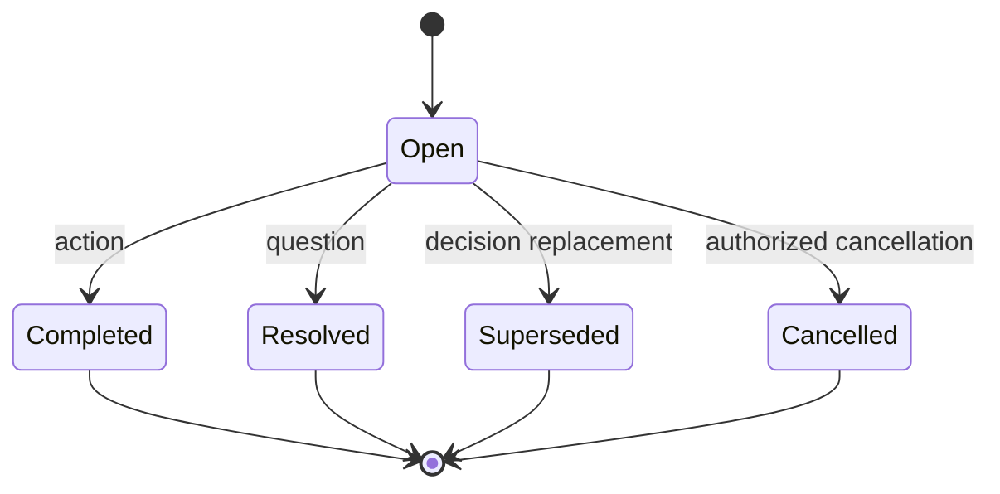

# Architecture

## Design goal

ProofThread turns explicit Telegram commands into a small, auditable operational ledger. The design prioritizes evidence, human confirmation, least-data collection, and predictable state transitions over ambient surveillance or autonomous interpretation.

## Components

### Telegram boundary

`handlers/ledger.py` owns Telegram-specific concerns:

- command and callback parsing;
- group and administrator checks;
- Telegram user labels and IDs;
- message-source extraction;
- evidence-link construction; and
- HTML response rendering.

Handlers do not issue SQL directly.

### Domain service

`service.py` owns:

- record validation;
- group scoping;
- record-ID resolution;
- lifecycle transitions;
- decision supersession;
- due-reminder selection; and
- structured export.

This keeps business behaviour testable without Telegram network calls.

### Persistence

`models.py` defines three primary tables:

- `chat_settings` — title, timezone, and retention configuration;
- `ledger_records` — decisions, actions, questions, evidence, ownership, and status; and
- `ledger_events` — append-style lifecycle events for accountability.

SQLAlchemy's async interface supports SQLite through `aiosqlite` and PostgreSQL through the optional `asyncpg` dependency.

### Scheduling

APScheduler runs a coalesced, single-instance reminder job. It selects open actions with due dates inside the configured window, sends the reminder to the originating group/topic, and records successful delivery.

For horizontal scaling, replace the in-process scheduler with a distributed scheduler or database-backed lock.

### Runtime modes

- **Polling** removes any existing webhook and is intended for local development or a single persistent worker.
- **Webhook** exposes an aiohttp endpoint and validates Telegram's configured secret header.

## Record lifecycle

Only transitions valid for the record kind are accepted. The actor must be the record creator, the directly linked action owner, or a Telegram group administrator.

## Evidence model

When a command replies to a message, ProofThread stores the message ID, stable link when Telegram exposes one, and at most 320 characters of source text. The bot never claims that the excerpt proves truth; it proves which visible message the group used as its source.

## Deliberate non-goals for v0.1

- full-chat ingestion;
- autonomous declaration of decisions;
- semantic surveillance of members;
- project-management-suite replacement;
- tamper-proof or cryptographically signed exports; and
- multi-instance reminder scheduling without a distributed lock.

